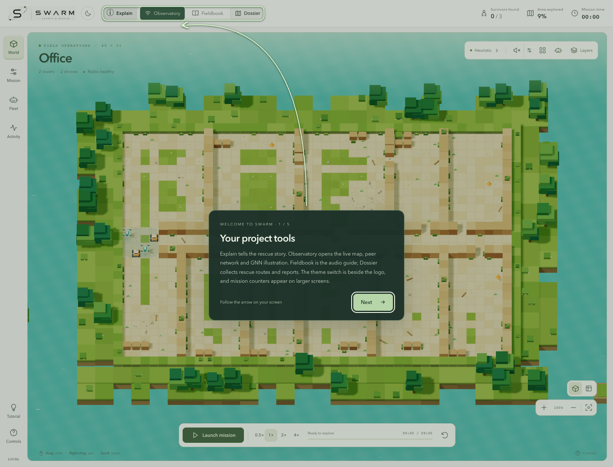
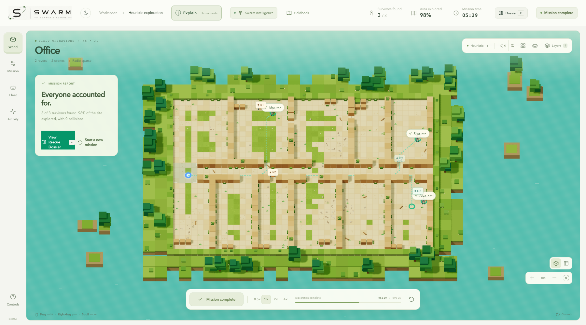
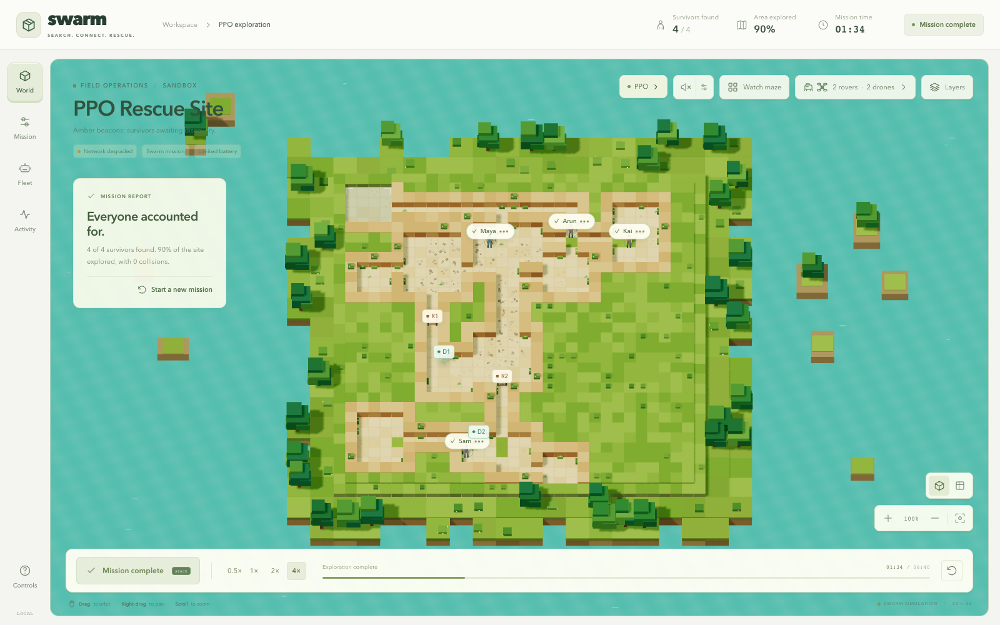

# SWARM SAR — Search, Coordination and Rescue Simulation

> Send a heterogeneous robot team into an unfamiliar simulated disaster site, share discoveries and turn the mission into an operator-readable rescue report.

**Recognition:** AI Manthan 2.0 National Hackathon winner, AITR; **₹50,000 prize** (recorded in the project résumé).

**Documentation and narrated fieldbook:** [SWARM SAR — swarmsar.vercel.app](https://swarmsar.vercel.app)

## Mission concept

SWARM SAR explores coordinated search when GPS is unavailable and a damaged site may be unsafe for human entry. A browser-based mission workspace lets an operator inspect a generated environment, configure a fleet, observe exploration and review the route and survivor evidence. The codebase also contains a Python simulation and learning experiments, plus a separate robotics path built around ROS 2 and Gazebo.

This is a simulation and research/teaching platform. It does not control deployed rescue robots and its results do not establish field readiness.

## App screenshots

These in-app captures show an initialized 3D mission workspace and a completed route dossier. They were taken after the scene loaded; they are not the initial blank canvas or loading state.

## What the prototype brings together

- **Mission workspace:** 3D view of the environment, fleet, map layers and operator controls.
- **Heterogeneous team:** ground rovers and aerial drones contribute complementary observations.
- **Local exploration:** agents observe and update local map knowledge in a GPS-denied scenario.
- **Shared discoveries:** information from separate agents is coordinated into a broader mission view.
- **Learning experiments:** recurrent PPO work and an experimental graph-based policy track.
- **Rescue dossier:** map evidence, found survivors and route guidance are compiled for an operator.
- **Robotics research path:** separate ROS 2 / Gazebo / RViz material explores moving from browser simulation toward robotics tooling.

## System architecture

~~~mermaid
flowchart LR
  OP[Mission operator] --> UI[React and Three.js mission control]
  UI --> STATE[Zustand mission state]
  STATE --> WORLD[Generated disaster map]
  WORLD --> OBS[Local observation per agent]
  OBS --> CTRL[Heuristic or learned policy]
  CTRL --> AGENTS[Rovers and drones]
  AGENTS --> OBS
  AGENTS --> MAP[Local discoveries and survivor evidence]
  MAP --> SHARE[Decentralized coordination]
  SHARE --> WORLD
  MAP --> DOSSIER[Rescue route and mission dossier]
  TRAIN[Python simulation and PPO experiments] --> CTRL
  ROS[ROS 2 / Gazebo research stack] -. separate integration path .-> AGENTS
~~~

### Mission loop

~~~mermaid
sequenceDiagram
  participant O as Operator
  participant M as Mission workspace
  participant A as Rover or drone agent
  participant P as Local policy
  participant S as Shared mission state
  O->>M: Select site, fleet and exploration mode
  M->>A: Start simulation with local observations
  A->>P: Current sensor/map state
  P-->>A: Next movement or search action
  A->>S: New coverage, discovery or survivor evidence
  S-->>M: Update map and operator-visible mission state
  M->>O: Show progress, confidence and available actions
  O->>M: Pause, inspect or complete mission
  M->>O: Produce route summary and rescue dossier
~~~

## Engineering shape

- **Browser simulator:** React 18, TypeScript, Three.js, React Three Fiber, Drei and Zustand.
- **Learning experiments:** Python simulation stack with multi-agent environments and recurrent PPO; the GNN work is experimental.
- **Robotics:** ROS 2, Gazebo and RViz documentation and workspace are separate from the browser interface.
- **Evidence:** screenshots and recorded runs show the rendered simulation; model performance must be assessed from repeatable experiment reports, not a screenshot.

## Evaluation and limits

Useful measures include area coverage, time to discovery, collisions, communication cost, route length and survivor recall. Every measure should be tied to a defined map, seed, policy and baseline. The visual interface helps explain coordination but is not itself evidence that a policy generalizes to real rubble, sensor failures or radio loss. Hardware testing would require a separate safety and validation program.

## Award context

The portfolio résumé identifies SWARMOS as the AI Manthan 2.0 national hackathon winner at AITR and records a ₹50,000 prize. The award belongs to the team project; it should not be read as a field deployment certification.

## Repository

This public project page presents the mission architecture, screenshots and research context. The linked fieldbook provides the visitor-facing documentation and narrated project story.
